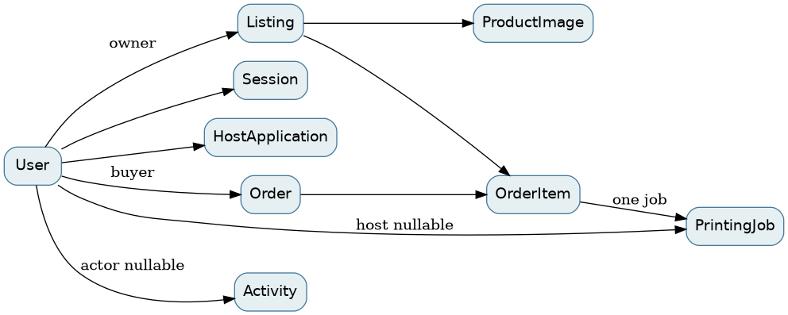
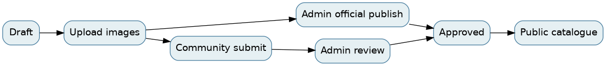
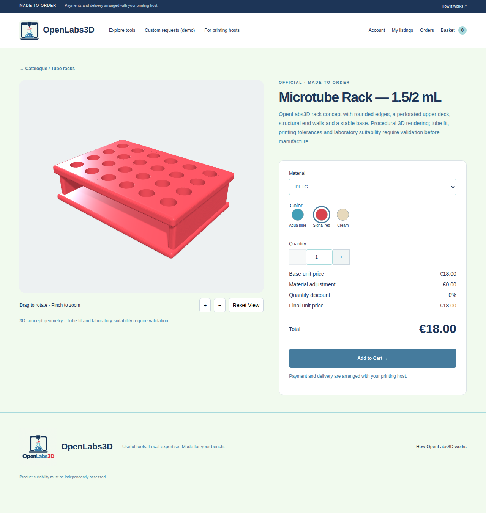

# OpenLabs3D — State of the Art & Technical Architecture Report

**Assessment date:** 28 October 2026  
**Branch:** v2  
**Assessed revision:** e82d3fe2ade627dd01e203d3e1c498e17ca44e3d  
**Version:** no formal release version found. Working tree was clean before report creation. This report and its assets are uncommitted.

## Executive summary

OpenLabs3D is a self-hosted marketplace for laboratory accessories made by independent printing hosts. Visitors browse approved listings, configure supported rack models, and submit order requests. Administrators moderate listings and host applications. Approved hosts discover jobs matching their declared materials and manage production status. Money and shipping are arranged outside the platform.

The implementation supports internal testing and a controlled demonstration. A closed beta would require resolving the workflow and security findings below, tested operations and a clear operator support process. Public production readiness is not established. The application handles real user and order data, but payments, shipment integration, notifications, password recovery, professional model upload and full host capability matching are absent. Rack geometries are concepts, not dimensionally validated designs.

**Current evidence:** 20 backend tests passed on a temporary SQLite database; read-only live browser checks and an independent isolated browser order passed. Previous reports are historical evidence, not proof of this assessment. GitHub MCP timed out on DNS; authenticated Git transport confirmed remote v2 matches the local commit. Context7 and Playwright MCP responded.

## Contents

1 Project overview; 2 Stack; 3 Architecture; 4 Repository; 5 Database; 6 Identity; 7 Feature inventory; 8 Administration; 9 Hosts; 10 Products; 11 Configurator; 12 Pricing; 13 Cart and checkout; 14 Orders and jobs; 15 API; 16 Infrastructure; 17 QA; 18 Security; 19 Maintainability; 20 Maturity; 21 Limitations; 22 Roadmap; 23 Conclusions; Appendices A–E.

## 1. Project overview

The service is a catalogue and order-request system rather than a payment marketplace. Three official rack concepts are seeded when an active administrator exists. Existing listings can have seller-supplied images. The UI also retains some browser-local demo functions for custom requests. Source: `backend/app/seed_collection.py`, `operations.js`, `app.js`.

## 2. Technology stack

HTML, CSS and vanilla JavaScript render a hash-routed single-page interface. Vendored Three.js 0.180.0 renders GLB meshes. FastAPI and Pydantic implement HTTP endpoints; SQLAlchemy accesses SQLite; Alembic migrates the schema. Pillow validates and re-encodes images. Argon2 hashes passwords. Caddy serves assets and proxies `/api/*`. Docker Compose runs Caddy and a Python backend. Versions are bounded ranges in `backend/requirements.txt`, not a lockfile.

## 3. Software architecture

Browser requests use same-origin fetch with a session cookie and CSRF header. Caddy serves the frontend and static `assets/` directly; `/api/*` reaches FastAPI on the Compose network. SQLAlchemy opens the SQLite database in `app_data`; the backend stores uploaded product photos under the same volume. GLB and official renders are repository assets mounted read-only into Caddy, not database blobs. Caddy persists certificates/configuration separately in production. See `compose.yaml`, `compose.production.yaml`, `caddy/Caddyfile` and `backend/app/database.py`.

## 4. Repository structure

`index.html`, `style.css`, `app.js`, `marketplace.js`, `operations.js`, `collection.js` and `assets/configurator.js` compose the UI. `backend/app` holds models, API, schemas, pricing and operations; `backend/migrations` provides four Alembic revisions. `assets/models` and `assets/products` hold rack assets. `backend/tests` exercises API behavior; `tests/browser_workflow.py` is an opt-in Selenium workflow. `scripts/render_racks.py` creates Blender models/renders. The earlier implementation reports are useful background but are not authoritative.

## 5. Database architecture

User owns listings; images belong to listings. A buyer owns orders; each order contains order items, each linked to its listing and to one printing job. A host application is unique per user; a job may be assigned to a host user. Activity links to an optional actor. The cart is **not** a SQL entity: it is browser localStorage. Category is a name string on Listing rather than a foreign key. Pricing rules are JSON text on Listing, and supported collection colors are defined in backend code. `approved_by` is an integer, not a declared foreign key. See complete field inventory in Appendix B and `backend/app/models.py`.

SQLite connections enable foreign keys, WAL and a 15-second busy timeout. The application checks role and state constraints and uses indexes for public listings, statuses, references and foreign keys. Order uniqueness uses `(buyer_id, idempotency_key)`. Alembic revisions are additive in the inspected chain. The code uses a version column for listing concurrency. The configured app database and uploaded files persist in `app_data`; this audit did not inspect production records directly.

## 6. Authentication and user roles

Registration validates email and password length, hashes the password with Argon2, creates a buyer and a session. Random session tokens are stored hashed; cookies are HttpOnly, SameSite=Lax, with Secure enabled in production. Session expiry is 14 days. Login, registration and sensitive deletion are throttled by an in-process limiter. CSRF requires a session token header and checks Origin/Sec-Fetch-Site. Role checks distinguish buyer, host and admin. Profile display name updates and password-confirmed deletion exist. Password change, reset and email verification are not implemented. Admin account bootstrap is a local command, `python -m app.create_admin`.

## 7. Complete feature inventory

Statuses use: VERIFIED = independently executed in this assessment; NOT VERIFIED = present in code, not exercised now; PARTIAL = present with material gaps; BROKEN = reproducibly failed; NOT IMPLEMENTED = absent; UNKNOWN = insufficient evidence. Test-suite evidence counts as executed verification, but not as a physical-device or production deployment test.

- Public homepage, catalogue and search/filter: VERIFIED for rendering and catalogue; search/filter server logic tested in backend suite. Homepage uses approved records. `collection.js`, `marketplace.js`, `main.py:143`.
- Responsive layout: VERIFIED for absence of horizontal overflow at 390, 768 and 1440 px in isolated browser; not a physical-device test.
- Account registration, sessions and buyer/admin boundary: VERIFIED in isolated browser; login/logout also exercised by pytest. Password reset/change: NOT IMPLEMENTED.
- Official publishing and community moderation: VERIFIED by backend tests; browser publish dialog is prior-report evidence only. Any authenticated user can create a community listing, not only an approved host (`main.py:167`).
- Uploads and WebP: VERIFIED by pytest including transparency; photos have a maximum count, size and dimension checks. Image-only detail fallback: prior browser evidence; implementation present.
- Admin overview, users, hosts, products, orders, categories, settings and activity: PARTIAL; endpoints/UI exist, with backend regression coverage; not every screen independently retested. Last admin can be deleted (README documents bootstrap recovery).
- Host application/review and jobs: VERIFIED at API test level; matching is only by material. Real-world qualification, print capacity and region matching are PARTIAL.
- Configurator: VERIFIED for GLB canvas, existing colors and quantity/quote in current browser. Physical touch, STL loading and GPU failure behavior NOT VERIFIED. Product-specific color management and model uploads NOT IMPLEMENTED.
- Pricing: VERIFIED by tests for rules, rounding, invalid options and tampering. Production catalog currently offers only configured materials, commonly PETG; sample multipliers are not silently enabled.
- Cart, checkout, order and job snapshot: VERIFIED in isolated browser and API tests. Cart is local only; no server cart or cross-device sync. Payment, invoicing, shipping and notifications NOT IMPLEMENTED.
- Custom request, demo basket and some legacy behaviors: PARTIAL; browser-local demonstration, not persisted marketplace workflows. Sources `app.js`, `operations.js`.

## 8. Administrator dashboard

Authenticated admins see counts, activity, listings, hosts, users, orders, settings and categories. Their official listing creation starts as draft, uploads images, and `POST /api/listings/{id}/publish` checks admin, ownership, official type and completeness before approval and timestamp/activity. Community listings must enter pending review; self-approval restrictions apply. Admin can suspend/restore users and hosts, reject, approve or archive listings, cancel eligible orders and reopen eligible jobs. Pricing editor accepts raw JSON basis-point rules; a structured validated UI would improve usability. Evidence: `backend/app/main.py:167`, `backend/app/operations.py:139`, `operations.js`, `assets/configurator.js`.

## 9. Printing host system

A buyer submits profile, location, equipment, technologies, materials and capabilities via `/api/host/application`; administrator approval changes role to host. Active hosts list matching jobs and accept with a conditional SQL update requiring available status and empty host; conflicting acceptance returns 409. A host advances accepted → printing → ready → completed. Buyer contact and address are revealed after assignment. Matching uses case-insensitive declared material only; actual dimensions, region and capacity require manual checking. Admin can reopen an accepted job. `backend/app/operations.py:113`, `:199`.

## 10. Product management

Authenticated users create drafts and edit owned listings; administrators may manage others. Submission requires title, description, active category, positive price, material, dimensions and compatibility. Approved edits change publication state; archive retains references. Official products receive immediate approval on the authenticated admin path. Uploaded JPEG/PNG/WebP is decoded with Pillow, bounded, orientation corrected and re-encoded in original format; old JPEG paths are supported. Images are access controlled via listing visibility. Up to five photos and 5 MB each by default. Category and material are free-text listing attributes; variant colors are restricted to collection listings. See `backend/app/main.py:167–273`, `backend/app/config.py`.

## 11. 3D product configurator

The detail page receives `configurator.model_url`, materials, colors, max quantity and rules through listing JSON. `assets/configurator.js` lazily imports `assets/viewer.js`; `GLTFLoader` loads local GLB, `OrbitControls` handles pointer and touch, a perspective camera frames bounding-box geometry, and buttons zoom/reset. A color change updates existing mesh material color; material changes roughness. Render-on-demand, pixel-ratio cap and disposal limit cost. STLLoader is present but no upload/validation workflow exists. On no model/failure the image remains. Blender generated actual rack meshes with 24, 12 and 6 openings. These are visual concepts, not verified tube-fit or manufacturing specifications. No evidence of production performance across devices or physical touch testing was collected.

## 12. Pricing engine

`backend/app/pricing.py` uses stored base cents, material factors in basis points, highest eligible discount in basis points, and integer half-up rounding at adjusted-unit and discounted-unit stages. Quantity multiplies final unit cents. Endpoint `/api/listings/{id}/quote` validates published status and options; `/api/listings/{id}/pricing` is admin-only. Default is existing listing material at factor 10000, no discounts. Admin can enable other materials deliberately; availability is not automatically reconciled with host capabilities. Orders recompute quotes and reject stale or manipulated expected unit price with 409. Historical order lines snapshot final unit price, material, color, quantity and title; rules and discount breakdown are not snapshotted.

## 13. Shopping cart and checkout

A selected configuration persists in localStorage and is quoted before add. Cart lines include product ID, material, color, quantity, displayed unit price and optional thumbnail. Cart opening and quantity edits re-quote; checkout sends configurations and expected unit prices. Server reloads published listings, validates options/prices, creates order and per-item jobs transactionally. A sessionStorage idempotency key supports retries. Cart is device/browser-local and may be lost when browser data is cleared. No payment is collected. See `assets/configurator.js`, `operations.js`, `backend/app/operations.py:165`.

## 14. Orders and printing jobs

Order stores buyer, contact/address, status, total and reference. Each item stores listing, title, material, color, dimensions, quantity and unit cents. Job references order and item and optionally host. Aggregate status is synchronized from job statuses. Historical prices are independent of later listing changes. The browser audit registered an isolated buyer, ordered two cream PETG racks and verified €36.00 and matching job fields. End-to-end post-restart persistence of a completed order was not tested in this assessment.

## 15. API architecture

FastAPI provides JSON request/response APIs and `/api/docs`; routes are enumerated in Appendix A. Public endpoints expose published listings, categories, settings and quotes. Account and host endpoints require sessions; mutation requires CSRF, admin operations require admin. No server cart or payment endpoint exists. Most errors use 401/403/404/409/422, stale optimistic writes return 409 and SQLite contention returns 503. The endpoint inventory is generated from the actual FastAPI OpenAPI specification; authentication qualifications are based on route dependency inspection and should be read with source for ownership and status checks.

## 16. Infrastructure and deployment

Development Compose maps Caddy port 8080; production override binds 80/443 and sets `APP_ENV=production`/domain. Backend is not exposed directly. Dockerfile runs Alembic upgrade before Uvicorn as non-root user. Caddy sets security headers and production HSTS. `README.md` describes backup using SQLite backup API and a tar of uploads, plus restore. Backups contain personal information and require secure storage and restore drills. Seed startup depends on an active admin; admin creation after startup requires restart or explicit seed invocation. Logging is container stdout; no structured monitoring or centralized alerting is configured. No production backup restore was attempted.

## 17. Automated testing and browser verification

- Current execution: `PYTHONPATH=/tmp/openlabs3d-test-deps:backend python3 -m pytest backend/tests -q` → **20 passed, 0 failed, 0 skipped**, 3 dependency deprecation warnings, 5.12 seconds. No coverage measurement collected. Tests use temporary or overridden SQLite databases; see `backend/tests`.
- Live read-only Playwright: homepage, catalogue (four listings), microtube GLB canvas, red color input and €18 quote succeeded. Requests for listing, quote and GLB returned 200. Signed-out `GET /api/auth/me` returned expected 401 and appeared as a console error. GPU/browser warnings were present.
- Isolated Playwright: registration, buyer admin denial, rack configuration, cart, checkout, order/job snapshot and viewport overflow checks passed. Quantity 2, PETG, cream, €18 each and €36 total were observed. No production users/products/orders were created.
- Current assessment did not independently exercise admin publication, host approval, job acceptance, all material-rule changes, physical touch, STL, fallback failure or restore. Backend tests and `CONFIGURATOR_REPORT.md` provide additional or historical evidence only.

## 18. Security assessment

- **High — session/password lifecycle:** no password change/reset, email verification or explicit session management UI; compromised sessions can persist until expiry/logout. Evidence `main.py:50–140`. Add recovery, session revocation and email verification before public launch.
- **Medium — CSP/XSS defense:** Caddy allows `unsafe-inline` scripts and styles; several UI layers build HTML strings. `esc()` exists, but any missed interpolation becomes more dangerous. Evidence `caddy/Caddyfile`, `app.js`. Audit all sinks, eliminate inline handlers and use a nonce/hash CSP. No exploit was attempted.
- **Medium — business eligibility:** host matching checks only declared material; no automated region, dimensions, capacity or product-specific qualification. Unsuitable hosts could accept jobs. `operations.py:199–227`. Model explicit capabilities and require validated matching.
- **Medium — rate limiting:** process-local limiter resets on restart and is not shared across workers; not sufficient for distributed abuse. `main.py:34`. Add proxy/shared limiting and monitoring.
- **Medium — privacy and operations:** contact/address and backups contain personal information; no encryption or retention controls are configured in source. Limit access, encrypt backups and define retention/restoration.
- **Low — data integrity:** `approved_by` is not an FK, dimensions/category and pricing configuration are free text/JSON. Validate through migrations and schema constraints.
- **Informational — safeguards observed:** parameterized SQLAlchemy queries, Argon2, hashed session tokens, CSRF/origin checks, upload decoding/size limits, randomized storage paths, draft visibility checks, server-side pricing, conditional job acceptance. These are source observations plus tests, not a penetration test. No confirmed SQL injection or traversal exploit was demonstrated.

## 19. Code quality and technical debt

Several scripts override global `render`, `product`, `card` and other functions in load order. This makes lifecycle, race conditions and regressions hard to reason about. Consolidate routing and components with explicit interfaces and viewer teardown. Large one-line templates reduce reviewability. Separate order/pricing services from routes and remove circular imports (`operations.py` imports `main.py`). Introduce dependency lockfiles and CI, migration upgrade/rollback tests, deterministic browser fixtures and structured logging. README describes old sample catalogue behavior and requires reconciliation with current collection. Prior reports accurately describe historical checks but cannot replace repeatable QA.

## 20. Project maturity evaluation

- Frontend: internal testing; functional responsive pages; global overrides and mixed demo flows need consolidation.
- Backend: internal testing; meaningful validation and APIs; service boundaries and workflows need hardening.
- Database: internal testing; migrations and FKs; free-text capabilities and SQLite contention limit growth.
- Identity/security: prototype/internal; Argon2 and CSRF exist; recovery, verification and session management missing.
- Marketplace/admin: internal; moderation and dashboards exist; structured administration and complete workflows needed.
- Host/order: internal; conditional job acceptance and persisted snapshots; matching, payments and shipping incomplete.
- Testing: internal; 20 passing tests, limited automated browser/device/restore coverage.
- Deployment/documentation: internal; Compose, HTTPS configuration and backup procedure exist; production operations, monitoring and documentation accuracy need work.

The evidence supports a prototype and internal testing, not a claim of public production or closed-beta readiness. Closed beta requires explicit threat model, operational support, realistic host qualification and user acceptance tests.

## 21. Known bugs and limitations

1. Homepage newest and featured sections use bounded lists; a newly published product may leave the homepage as newer products arrive. Catalogue remains authoritative.
2. Listing material filtering uses the single `Listing.material` string, not all configured material options (`main.py:150`). A product configured for additional materials can be omitted from those filtered results. Source-confirmed mismatch; not browser-reproduced in this assessment.
3. Cart is browser-local, no cross-device persistence or reservation. Availability and price can change between quote and order.
4. Host matching checks material only. User-created products have no 3D model upload workflow and no configurable colors.
5. Test browser console shows expected auth 401 and graphics warnings; no conclusion about unsupported physical devices.
6. Password recovery, payment, invoice, shipping, notifications and real custom request workflow are absent. Demo features remain local.

## 22. Development roadmap

- **P0 — Identity and security:** Add password reset, email verification, session revocation and rate limiting across instances. Value: account recovery and reduced compromise impact. Complexity: medium/high; dependencies: email delivery and threat model. Acceptance: recovery tokens expire and are single-use; revoked sessions fail; abuse limits survive restart.
- **P0 — Host eligibility:** Normalize capabilities and match material, size, location and capacity before acceptance. Value: fewer unfulfillable orders. Complexity: high; dependencies: host data migration and agreed matching rules. Acceptance: incompatible host cannot view/accept a job; simultaneous acceptance produces one winner.
- **P1 — Correct product search:** Include configured materials in filters and add API/UI regression coverage. Value: discoverable inventory. Complexity: medium; dependencies: configuration representation. Acceptance: every enabled material appears in results before pagination.
- **P1 — QA and operability:** CI for tests, isolated browser flows, migration/restore and mobile device checks; structured logs and alerts. Value: safer releases and recoverability. Complexity: medium; dependencies: CI runner and backup policy. Acceptance: clean-environment pipeline and successful restore drill with measured recovery time.
- **P1 — Administration:** Replace JSON pricing editor with validated fields and show impact, maintain audit history. Value: fewer operator errors. Complexity: medium; dependencies: pricing model. Acceptance: unauthorized edits rejected; saved rules quote correctly; historical order totals unchanged.
- **P2 — Marketplace MVP:** Structured product specs, safe model uploads and validation, quotation lifecycle, notifications and delivery status. Value: wider product range and communication. Complexity: high; dependencies: storage, security review and workflow design. Acceptance: validated uploads, explicit quote acceptance and traceable updates.
- **P3 — Production marketplace:** Select payment/shipping providers, commissions and reconciliation; privacy, tax and regulatory analysis; monitoring, scaling and offsite encrypted backups. Value: commercially operable service. Complexity: high; dependencies: legal/business decisions and operational ownership. Acceptance: audited payment lifecycle, tested fulfillment and recovery, documented privacy and incident response.

## 23. Conclusions

The application has a coherent persistent core and an operational product configurator, backed by server-authoritative pricing and tests. It remains an internal-stage marketplace with deliberate gaps in fulfillment qualification, account lifecycle and commerce integrations. Prioritize those gaps and repeatable operations before public release.

## Appendix A — API endpoint inventory

The following inventory is generated from the current FastAPI schema and route dependency signatures. Body schema names are Pydantic models; default success responses are JSON unless documented otherwise. `mutate` includes CSRF and origin checks. Ownership, state and detailed validation remain in the referenced handler. 401 = no session, 403 = authorization/CSRF, 404 = missing or hidden, 409 = conflict, 422 = validation, 503 = database contention where applicable.

- **GET /api/health** — Health. Access: Public. Input: none. Documented HTTP: 200. Handler: `app.main.health`.
- **POST /api/auth/register** — Register. Access: Public. Input: Register. Documented HTTP: 201, 422. Handler: `app.main.register`.
- **POST /api/auth/login** — Login. Access: Public. Input: Login. Documented HTTP: 200, 422. Handler: `app.main.login`.
- **GET /api/auth/me** — Me. Access: Session. Input: none. Documented HTTP: 200. Handler: `app.main.me`.
- **POST /api/auth/logout** — Logout. Access: Session + CSRF. Input: none. Documented HTTP: 200. Handler: `app.main.logout`.
- **GET /api/listings** — Catalogue. Access: Public. Input: q, category, sort, featured, page, per_page, material, max_price_cents, max_width. Documented HTTP: 200, 422. Handler: `app.main.catalogue`.
- **GET /api/listings/mine** — Mine. Access: Session. Input: none. Documented HTTP: 200. Handler: `app.main.mine`.
- **GET /api/listings/{listing_id}** — Detail. Access: Public / optional session. Input: listing_id. Documented HTTP: 200, 422. Handler: `app.main.detail`.
- **POST /api/listings** — Create. Access: Session + CSRF. Input: ListingInput. Documented HTTP: 201, 422. Handler: `app.main.create`.
- **PATCH /api/listings/{listing_id}** — Edit. Access: Session + CSRF. Input: ListingPatch, listing_id. Documented HTTP: 200, 422. Handler: `app.main.edit`.
- **DELETE /api/listings/{listing_id}** — Archive. Access: Session + CSRF. Input: listing_id. Documented HTTP: 200, 422. Handler: `app.main.archive`.
- **POST /api/listings/{listing_id}/submit** — Submit. Access: Session + CSRF. Input: listing_id. Documented HTTP: 200, 422. Handler: `app.main.submit`.
- **POST /api/listings/{listing_id}/publish** — Publish. Access: Admin + CSRF. Input: listing_id. Documented HTTP: 200, 422. Handler: `app.main.publish`.
- **POST /api/listings/{listing_id}/images** — Upload. Access: Session + CSRF. Input: Body_upload_api_listings__listing_id__images_post, listing_id. Documented HTTP: 201, 422. Handler: `app.main.upload`.
- **GET /api/listings/{listing_id}/images/{image_id}** — Image. Access: Public / optional session. Input: listing_id, image_id, thumbnail. Documented HTTP: 200, 422. Handler: `app.main.image`.
- **DELETE /api/listings/{listing_id}/images/{image_id}** — Remove Image. Access: Session + CSRF. Input: listing_id, image_id. Documented HTTP: 200, 422. Handler: `app.main.remove_image`.
- **PUT /api/listings/{listing_id}/images/order** — Reorder. Access: Session + CSRF. Input: Reorder, listing_id. Documented HTTP: 200, 422. Handler: `app.main.reorder`.
- **GET /api/admin/listings** — Admin List. Access: Admin. Input: none. Documented HTTP: 200. Handler: `app.main.admin_list`.
- **POST /api/admin/listings/{listing_id}/approve** — Approve. Access: Admin + CSRF. Input: listing_id. Documented HTTP: 200, 422. Handler: `app.main.approve`.
- **POST /api/admin/listings/{listing_id}/reject** — Reject. Access: Admin + CSRF. Input: Reject, listing_id. Documented HTTP: 200, 422. Handler: `app.main.reject`.
- **POST /api/listings/{listing_id}/quote** — Price Quote. Access: Public. Input: QuoteInput, listing_id. Documented HTTP: 200, 422. Handler: `app.main.price_quote`.
- **PUT /api/listings/{listing_id}/pricing** — Pricing Rules. Access: Admin + CSRF. Input: Rules, listing_id. Documented HTTP: 200, 422. Handler: `app.main.pricing_rules`.
- **PATCH /api/profile** — Profile. Access: Session + CSRF. Input: ProfileInput. Documented HTTP: 200, 422. Handler: `app.operations.profile`.
- **DELETE /api/profile** — Delete Profile. Access: Session + CSRF. Input: AccountDeletion. Documented HTTP: 200, 422. Handler: `app.operations.delete_profile`.
- **DELETE /api/admin/users/{user_id}** — Admin Delete User. Access: Admin + CSRF. Input: AccountDeletion, user_id. Documented HTTP: 200, 422. Handler: `app.operations.admin_delete_user`.
- **GET /api/host/application** — My Application. Access: Session. Input: none. Documented HTTP: 200. Handler: `app.operations.my_application`.
- **PUT /api/host/application** — Save Application. Access: Session + CSRF. Input: HostApplicationInput. Documented HTTP: 200, 422. Handler: `app.operations.save_application`.
- **GET /api/admin/hosts** — Hosts. Access: Admin. Input: status. Documented HTTP: 200, 422. Handler: `app.operations.hosts`.
- **POST /api/admin/hosts/{host_id}/{decision}** — Decide Host. Access: Admin + CSRF. Input: Reject, host_id, decision. Documented HTTP: 200, 422. Handler: `app.operations.decide_host`.
- **POST /api/orders** — Create Order. Access: Session + CSRF. Input: OrderInput. Documented HTTP: 201, 422. Handler: `app.operations.create_order`.
- **GET /api/orders** — My Orders. Access: Session. Input: none. Documented HTTP: 200. Handler: `app.operations.my_orders`.
- **GET /api/host/jobs** — Host Jobs. Access: Session. Input: none. Documented HTTP: 200. Handler: `app.operations.host_jobs`.
- **POST /api/host/jobs/{job_id}/accept** — Accept Job. Access: Session + CSRF. Input: job_id. Documented HTTP: 200, 422. Handler: `app.operations.accept_job`.
- **POST /api/host/jobs/{job_id}/status** — Update Job. Access: Session + CSRF. Input: JobTransition, job_id. Documented HTTP: 200, 422. Handler: `app.operations.update_job`.
- **GET /api/admin/orders** — All Orders. Access: Admin. Input: none. Documented HTTP: 200. Handler: `app.operations.all_orders`.
- **POST /api/admin/orders/{order_id}/cancel** — Cancel Order. Access: Admin + CSRF. Input: order_id. Documented HTTP: 200, 422. Handler: `app.operations.cancel_order`.
- **POST /api/admin/jobs/{job_id}/reopen** — Reopen Job. Access: Admin + CSRF. Input: job_id. Documented HTTP: 200, 422. Handler: `app.operations.reopen_job`.
- **GET /api/admin/users** — Users. Access: Admin. Input: none. Documented HTTP: 200. Handler: `app.operations.users`.
- **POST /api/admin/users/{user_id}/{action}** — Change User. Access: Admin + CSRF. Input: user_id, action. Documented HTTP: 200, 422. Handler: `app.operations.change_user`.
- **GET /api/categories** — Categories. Access: Public. Input: none. Documented HTTP: 200. Handler: `app.operations.categories`.
- **GET /api/admin/categories** — All Categories. Access: Admin. Input: none. Documented HTTP: 200. Handler: `app.operations.all_categories`.
- **PUT /api/admin/categories/{category_id}** — Save Category. Access: Admin + CSRF. Input: CategoryInput, category_id. Documented HTTP: 200, 422. Handler: `app.operations.save_category`.
- **GET /api/settings** — Public Settings. Access: Public. Input: none. Documented HTTP: 200. Handler: `app.operations.public_settings`.
- **PUT /api/admin/settings** — Change Settings. Access: Admin + CSRF. Input: SettingsInput. Documented HTTP: 200, 422. Handler: `app.operations.change_settings`.
- **GET /api/admin/activity** — Activity. Access: Admin. Input: none. Documented HTTP: 200. Handler: `app.operations.activity`.
- **GET /api/admin/overview** — Overview. Access: Admin. Input: none. Documented HTTP: 200. Handler: `app.operations.overview`.

## Appendix B — Database models

### categories

- `id`: INTEGER, primary key, not null.
- `name`: VARCHAR(100), not null, unique.
- `sort_order`: INTEGER, not null.
- `active`: BOOLEAN, not null.
- Constraint: `name`.

### marketplace_settings

- `key`: VARCHAR(80), primary key, not null.
- `value`: VARCHAR(500), not null.

### users

- `id`: INTEGER, primary key, not null.
- `email`: VARCHAR(254), not null, unique, indexed.
- `password_hash`: VARCHAR(255), not null.
- `display_name`: VARCHAR(100), not null.
- `role`: VARCHAR(20), not null.
- `active`: BOOLEAN, not null.
- `created_at`: DATETIME, not null.
- `updated_at`: DATETIME, not null.
- Constraint: `role IN ('buyer','host','admin')`.
- Index: `ix_users_email` on email.

### activity_log

- `id`: INTEGER, primary key, not null.
- `actor_id`: INTEGER, nullable, foreign key → users.id.
- `action`: VARCHAR(100), not null.
- `subject`: VARCHAR(150), not null.
- `detail`: VARCHAR(1000), not null.
- `created_at`: DATETIME, not null, indexed.
- Index: `ix_activity_log_created_at` on created_at.

### host_applications

- `id`: INTEGER, primary key, not null.
- `user_id`: INTEGER, not null, unique, foreign key → users.id.
- `name`: VARCHAR(150), not null.
- `contact`: VARCHAR(200), not null.
- `country`: VARCHAR(100), not null.
- `region`: VARCHAR(150), not null.
- `printers`: VARCHAR(1000), not null.
- `technologies`: VARCHAR(500), not null.
- `materials`: VARCHAR(500), not null.
- `dimensions`: VARCHAR(200), not null.
- `capabilities`: TEXT, not null.
- `additional`: TEXT, not null.
- `status`: VARCHAR(20), not null, indexed.
- `rejection_reason`: VARCHAR(1000), not null.
- `reviewed_by`: INTEGER, nullable, foreign key → users.id.
- `reviewed_at`: DATETIME, nullable.
- `submitted_at`: DATETIME, nullable.
- `updated_at`: DATETIME, not null.
- Constraint: `user_id`.
- Constraint: `status IN ('draft','pending','approved','rejected','suspended')`.
- Index: `ix_host_applications_status` on status.

### listings

- `id`: INTEGER, primary key, not null.
- `owner_id`: INTEGER, not null, foreign key → users.id, indexed.
- `title`: VARCHAR(160), not null.
- `description`: TEXT, not null.
- `category`: VARCHAR(100), not null.
- `price_cents`: INTEGER, not null.
- `currency`: VARCHAR(3), not null.
- `material`: VARCHAR(200), not null.
- `dimensions`: VARCHAR(200), not null.
- `compatibility`: VARCHAR(300), not null.
- `listing_type`: VARCHAR(20), not null.
- `status`: VARCHAR(20), not null.
- `configuration`: TEXT, not null.
- `model_url`: VARCHAR(300), not null.
- `featured`: BOOLEAN, not null.
- `collection_key`: VARCHAR(80), nullable, unique.
- `approved_by`: INTEGER, nullable.
- `rejection_reason`: VARCHAR(1000), not null.
- `version`: INTEGER, not null.
- `created_at`: DATETIME, not null.
- `updated_at`: DATETIME, not null.
- `published_at`: DATETIME, nullable.
- Constraint: `collection_key`.
- Constraint: `status IN ('draft','pending','approved','rejected','archived')`.
- Constraint: `price_cents >= 0`.
- Constraint: `listing_type IN ('official','community')`.
- Index: `ix_listings_public` on status, published_at.
- Index: `ix_listings_owner_id` on owner_id.

### orders

- `id`: INTEGER, primary key, not null.
- `reference`: VARCHAR(40), not null, unique, indexed.
- `buyer_id`: INTEGER, not null, foreign key → users.id, indexed.
- `idempotency_key`: VARCHAR(80), not null.
- `contact`: VARCHAR(200), not null.
- `address`: VARCHAR(1000), not null.
- `status`: VARCHAR(20), not null, indexed.
- `total_cents`: INTEGER, not null.
- `currency`: VARCHAR(3), not null.
- `created_at`: DATETIME, not null.
- Constraint: `buyer_id, idempotency_key`.
- Constraint: `total_cents >= 0`.
- Constraint: `status IN ('pending','accepted','printing','ready','completed','cancelled')`.
- Index: `ix_orders_reference` on reference.
- Index: `ix_orders_buyer_id` on buyer_id.
- Index: `ix_orders_status` on status.

### sessions

- `token_hash`: VARCHAR(64), primary key, not null.
- `user_id`: INTEGER, not null, foreign key → users.id, indexed.
- `csrf`: VARCHAR(64), not null.
- `expires_at`: DATETIME, not null.
- Index: `ix_sessions_user_id` on user_id.

### order_items

- `color`: VARCHAR(40), not null.
- `id`: INTEGER, primary key, not null.
- `order_id`: INTEGER, not null, foreign key → orders.id, indexed.
- `listing_id`: INTEGER, not null, foreign key → listings.id.
- `title`: VARCHAR(160), not null.
- `material`: VARCHAR(200), not null.
- `dimensions`: VARCHAR(200), not null.
- `quantity`: INTEGER, not null.
- `price_cents`: INTEGER, not null.
- Constraint: `quantity > 0`.
- Constraint: `price_cents >= 0`.
- Index: `ix_order_items_order_id` on order_id.

### product_images

- `id`: INTEGER, primary key, not null.
- `listing_id`: INTEGER, not null, foreign key → listings.id, indexed.
- `filename`: VARCHAR(255), not null.
- `storage_path`: VARCHAR(80), not null, unique.
- `sort_order`: INTEGER, not null.
- `created_at`: DATETIME, not null.
- Constraint: `storage_path`.
- Index: `ix_product_images_listing_id` on listing_id.

### printing_jobs

- `id`: INTEGER, primary key, not null.
- `order_id`: INTEGER, not null, foreign key → orders.id, indexed.
- `item_id`: INTEGER, not null, unique, foreign key → order_items.id.
- `host_id`: INTEGER, nullable, foreign key → users.id, indexed.
- `status`: VARCHAR(20), not null, indexed.
- `updated_at`: DATETIME, not null.
- Constraint: `status IN ('available','accepted','printing','ready','completed','cancelled')`.
- Constraint: `item_id`.
- Index: `ix_printing_jobs_status` on status.
- Index: `ix_printing_jobs_host_id` on host_id.
- Index: `ix_printing_jobs_order_id` on order_id.

## Appendix C — Test results matrix

- Homepage/catalogue — expected published cards; observed 7 homepage cards and 4 catalogue entries — PASS, live read-only browser.
- Registration and session — expected buyer authenticated; observed isolated registration and account navigation — PASS.
- Authorization — expected buyer denied administration; observed Administrator access required — PASS.
- Viewer and color — expected GLB canvas and selectable color; observed canvas and red/cream selection — PASS for rendering and control selection; pixel-color correctness not independently quantified.
- Material/quantity/quote — expected valid server price; observed PETG, quantity 2 and €36 cart total — PASS. Additional multipliers/discounts are covered by pytest; interactive three-material switching was not repeated.
- Order/job — expected snapshot; observed cream, PETG, 2 and €18 unit price in order and available job — PASS, isolated database.
- Admin publication, host approval/acceptance, upload/WebP — covered by existing pytest; full browser workflows NOT REPEATED this assessment.
- Viewports 390/768/1440 — expected no overflow; none observed — PASS for width check, not full accessibility/device testing.
- API regression/security — 20 passed, 0 failed, 0 skipped; no coverage measurement.
- Console/network — expected signed-out 401, no unexpected failed API requests observed during live check; graphics warnings occurred. Browser audit intentionally elicited 403 for buyer admin access.

## Appendix D — Relevant source files

- `backend/app/main.py`: auth, listing, photo, quote and admin pricing routes.
- `backend/app/operations.py`: profile, host, job, order, category and admin operations.
- `backend/app/models.py`, `schemas.py`, `database.py`, `pricing.py`: model, validation, persistence, pricing.
- `backend/migrations/versions/`: schema evolution.
- `marketplace.js`, `collection.js`, `operations.js`, `assets/configurator.js`, `assets/viewer.js`: UI layers and viewer.
- `scripts/render_racks.py`, `assets/models/`, `assets/products/`: Blender source and assets.
- `backend/tests/`, `tests/browser_workflow.py`: automated evidence.
- `compose.yaml`, `compose.production.yaml`, `caddy/`, `backend/Dockerfile`, `backend/backup.py`: deployment and backup.

## Appendix E — Assessment methodology and evidence

Inspected the checked-out source and Git history at revision e82d3fe, ran backend pytest in isolated temporary databases, and performed read-only browser checks on port 8080 plus a separate temporary FastAPI/SQLite QA instance on port 8094. No production data or functionality was modified. Screenshots were captured during the audit. GitHub MCP returned a DNS timeout; local Git transport independently confirmed remote branch head. Playwright MCP and Context7 were operational. `README.md`, `IMPLEMENTATION_REPORT.md` and `CONFIGURATOR_REPORT.md` were checked as historical context; conflicting README demo descriptions are not treated as current behavior. This is a non-intrusive code and functional review, not a penetration test, legal opinion, accessibility certification, or manufacturing validation.

### Workflow traces

1. Registration: form → POST `/api/auth/register` → Pydantic validation/Argon2 → User + LoginSession → session cookie and CSRF → account UI.
2. Host application: form → PUT `/api/host/application` → authenticated validation → pending HostApplication → admin decision → host role. Production qualification is manual.
3. Official publication: draft/images → confirmation → POST publish → admin/owner/type/completeness checks → approved listing and activity → public catalogue.
4. Community publication: draft → submit → pending → admin approve/reject → catalogue if approved. Any registered buyer may submit under current code.
5. Configuration: product JSON → lazy GLB → controls/color/material/quantity → POST quote → validated integer calculation → UI price.
6. Cart: quote → browser localStorage → re-quote on cart display → persisted browser configuration; no database cart.
7. Checkout: CSRF request with items and idempotency key → validate/recalculate → transactional Order, OrderItem and PrintingJob snapshots → order history.
8. Job: approved host requests matching jobs → conditional acceptance → assignment/contact disclosure → printing/ready/completed transitions → aggregated order status.
