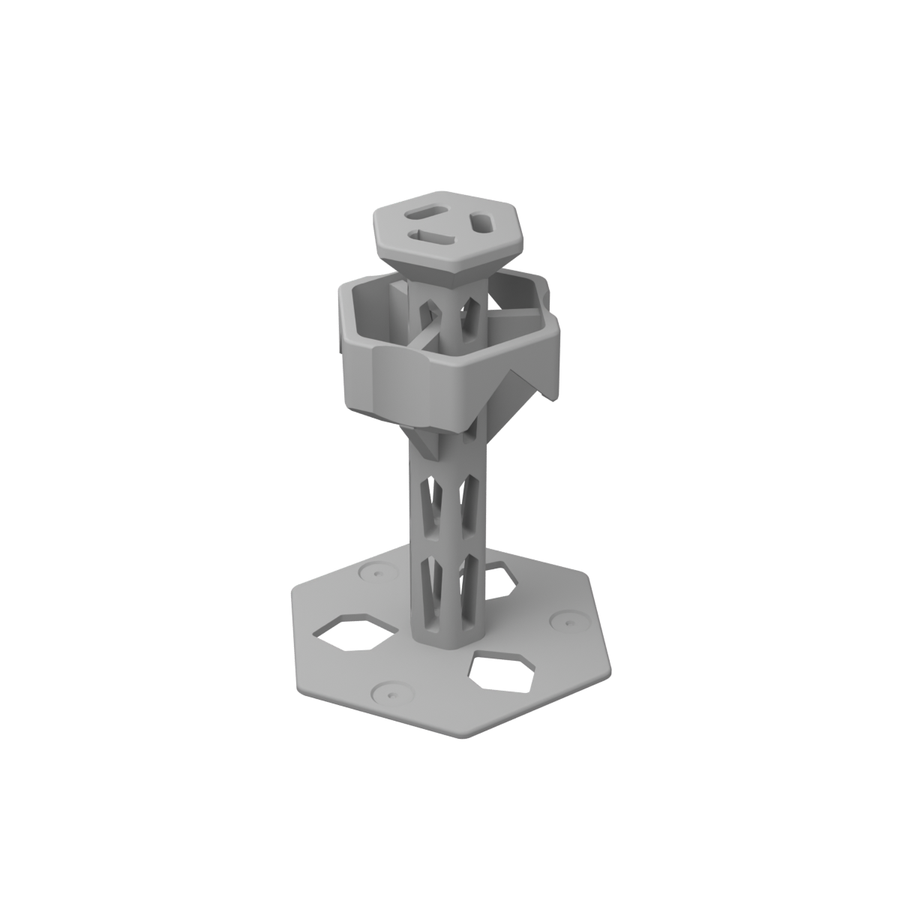

# Pipette holder — 3 positions, Bridge family

> **Archived revision 1** (single part, 212 mm), replaced on 2026-10-31 by the taller three-part kit in
> `../../pipette_holder/`. `build_pipette_holder.py` here is the build script of this revision; it expects
> the files at their original location, `official_products/pipette_holder/`.

A single-piece bench holder for three hook-hung single-channel pipettes, redesigned from the reference
`exaple_product/mechanical-pipette-holder.stl` (kept unchanged; SHA-256 recorded in `validation.json`).
It uses the same design language as the Bridge racks (`microtube_rack_24`, `centrifuge_rack_15ml_12`,
`centrifuge_rack_50ml_6`), so the collection reads as one family.

> **UNVERIFIED pipette fit.** Every fit dimension lives in `PIPETTE_FIT` in `source/model.py`. They are carried
> over from the reference geometry, not measured on any brand. Do the test print below before relying on it.



## Files

| Path | Purpose |
|---|---|
| `source/model.py` | Parametric CadQuery source (`PARAMETERS`, `PIPETTE_FIT`, `build()`) |
| `pipette_holder.stl`, `pipette_holder.3mf` | Printable part, in print orientation, millimetres |
| `renders/` | Studio still, thumbnail and viewer GLB from `backend/app/render_product.py` |
| `validation.json` | Measured results of `../build_pipette_holder.py` |
| `review/` | Orthographic review sheets (with and without stand-in pipettes), stand-in pipette STL (display only) |
| `reference/` | Measurements and render of the reference, made before this redesign |
| `concepts/` | Concept studies: `concepts.py` (A, B, C), `concept_b_fin_tiers_model.py`, their STLs and renders |

## How the reference works (and what was kept)

The reference is a 175.6 × 153.9 × 218 mm tripod with a 31 mm column and three positions at 120°. Each pipette
hangs by its **finger hook** over a rounded crest (r ≈ 22 mm, z ≈ 216 mm), with the hook nose in a D-shaped pocket.
The back of the handle leans on a **concave band** (r ≈ 43 mm, z ≈ 150–165 mm). The lower end hangs over a leg
with a raised-rim trough. Only the hook and the back of the grip touch the holder, so plunger and ejector buttons
stay free. These datums are preserved: hook rest at r 19–31 mm, nose pocket at r 11–19 mm, cradle contact at
r 41.9 mm, pipette axis at r 58 mm.

Weak points found: the mesh is not watertight (7 shells, slivers at z 102–117 mm). The loop bands are thin, with
≈45° inner overhangs. A tripod footprint puts the tipping edge 56.6 mm from the centre. The deep blind pockets
are hard to clean.

## Design

Built entirely from the Bridge vocabulary: rounded-polygon prisms with **7 mm vertical radii**, **1.6 mm** rolled
top perimeters, a **0.8 mm** bed chamfer, **gabled windows** (tapered piers, 45° roof, 2 mm tool fillets),
**1.1 mm entry chamfers** and the racks' **1.2/2.4 mm locating cone** where tips land. With *n* positions every
prism is a rounded 2*n*-gon with one face towards each pipette.

| Element | Function |
|---|---|
| Canopy (hex deck, z 189.5–212) | Finger hook rests on the flat deck. The nose drops into a chamfered 20 × 8 mm stadium slot, which also centres a 16 mm hook ±2 mm |
| Collar (hex ring, 6 mm wall, z 132–172) | Each pipette face carries a concave R22 cradle: handles up to Ø44 touch along its centre line, never on an edge. Between positions the ring spans on 45° gables |
| Webs (7 mm, one per pipette) | Carry each cradle straight down to the mast; lower edge rises at 50° |
| Mast (hex column, apothem 17) | Four tiers of gabled windows leave six piers; open for cleaning |
| Plinth (hex slab, 4 mm) | Hexagonal footprint (tipping edge 71.3 mm), tip wells with locating cone, pointed through-windows between positions |

## Concepts

All concepts share the reference datums and were checked against the same stand-in pipette (`concepts/`).

| Concept | Idea | Solid cm³ | PLA est. g | Tipping edge mm | Verdict |
|---|---|---|---|---|---|
| A Minimal Precision | Slim column, two 45° discs, tri-lobe plinth | 393.5 | 192 | 48.0 | Generic candlestick; small saddles; least stable |
| B Architectural Framework | Spline fins in line with the pipettes, round vaulted tiers, orbit ring | 231.9 | 192 | 78.5 | Lightest and most stable, but its own vocabulary, not the racks' |
| C Contemporary Industrial | Vase spine with flutes cut by the pipette envelope | 661.4 | 275 | 79.9 | Sculptural, very heavy, pawn-like |
| **Bridge tower (chosen)** | B's structure re-expressed in the rack vocabulary | **281.0** | **256** | **71.3** | Coherent with the racks; stable; open and cleanable |

B was the strongest engineering concept. It was carried through full refinement (`concept_b_fin_tiers_model.py`,
watertight and validated) before being re-expressed in the rack language to keep the collection coherent. That
costs about 64 g of filament and 7 mm of tipping margin compared with B. An earlier blade-between-positions variant
(`concept_b1` in `concepts.py`) was rejected because its crest ring floated as a separate solid.

## Comparison with the reference

| | Reference | This design |
|---|---|---|
| Envelope X × Y × Z (mm) | 175.6 × 153.9 × 218.0 | 164.1 × 144.0 × 212.0 |
| Solid volume | 330.9 cm³ (open mesh, section-integrated) | 281.0 cm³ |
| PLA, same estimate | 188 g | 256 g |
| Centre to tipping edge | 56.6 mm (tripod) | 71.3 mm (hexagon) |
| Mesh | not watertight, 7 shells | watertight single solid |

The solid volume drops 15 %, but the estimated filament **rises about 36 %**. The reference is mostly thick
solids, which print largely as 15 % infill. This design is thin walls and piers, which print almost entirely as
perimeters. The estimate is coarse (4 × 0.45 mm perimeters + 15 % infill over the whole surface); slice it to know.

## Printing

Print upright as modelled, plinth on the bed. No supports intended. PLA or PETG, 0.4 mm nozzle, 0.2 mm layers,
4 perimeters, 15–20 % infill, matching the racks. Fits every FDM printer in the seeded catalogue except the
180 mm cube class (checked against 250 × 210 × 220 mm). Measured (`validation.json`):

- Watertight, consistently wound single solid; STL and 3MF bounds and volumes identical. The B-rep volume,
  integrated in 1 mm slabs, matches the mesh to 0.001 %.
- No downward face steeper than 46.0° from vertical. Every face over 45° is a designed 45°/48° face within
  tessellation tolerance, and no face is over 50°.
- 0 floating regions at 0.2 mm layers. The check also catches regions that start from a single point.
- 0 mm³ intersection with the stand-in pipette envelope (0.6 mm clearance carved around it).
- Walls: collar 6 mm, webs 7 mm, plinth 4 mm, canopy rim 5.8 mm. The lowest sampled thicknesses (≈2 mm) are
  the feather edges where 48° undersides meet vertical walls, not thin walls.

Gable apexes are left sharp, so no window needs bridging. This differs from the racks, which round their crests
by 2 mm and accept a small bridge.

## Assumptions that need a physical prototype

- **Pipette fit.** Hook reach, hook width, nose size, handle radius and length below the hook are reference-
  derived defaults. Pipettes longer than 205 mm below the hook will rest their lower end in the tip well. That
  is harmless, but check it.
- **Buttons and labels.** Contact is only at the hook and the back of the grip. Confirm that no ejector or
  volume lock on your models sits on the back of the grip at the cradle height (z 142–169 mm).
- **Stability.** Assumes 120 g pipettes with their mass centre at 140 mm. An empty holder tips with ≈0.85 N
  pushed sideways at the deck (≈2.0 N with three pipettes). Tests to run: loaded tip-over, bumps, creep under load.
- **Strength.** No FEA or impact test. Check the mast piers and web roots on the first print.
- **Cleaning.** All surfaces are reachable through the windows. FDM surfaces still need a suitable cleaning
  protocol. No sterilisation or laboratory qualification is claimed.

## Suggested test print

Print the top 30 mm first (slicer cut at z = 182 mm): canopy and slots only. Check that each
pipette's finger hook sits flat on the deck with its nose in the slot. Then print the full part and check the
handle sits on the cradle, hangs vertically, clears its neighbours and lands over its well.

## Regenerate

```
cd official_products
/home/mcianci/mcp/cadquery-contrib/mcp-server/.venv/bin/python build_pipette_holder.py
cd ../backend && BLENDER_BIN=blender uv run --no-project --python 3.12 --with Pillow \
  python -m app.render_product ../official_products/pipette_holder/pipette_holder.stl \
  --output ../official_products/pipette_holder/renders
```

The product is **not published**: no listing, seed, price, host availability or website file was changed.
